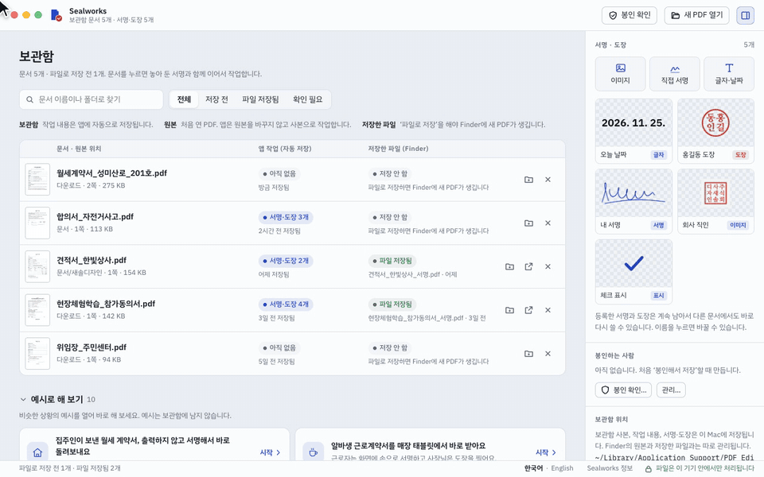
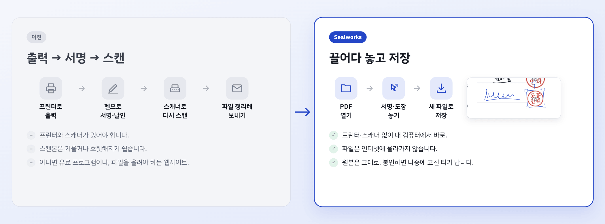
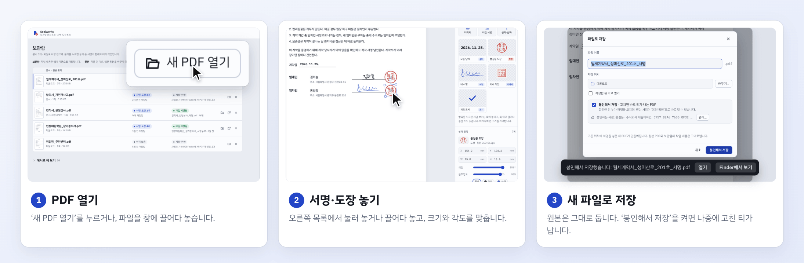
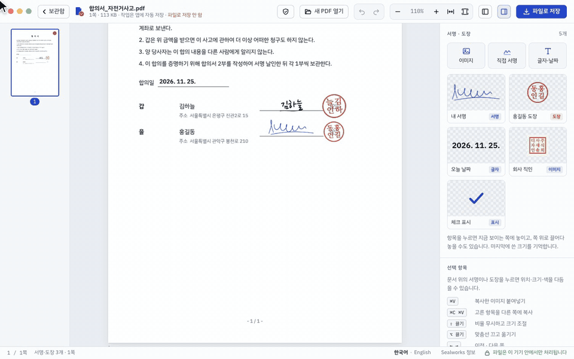
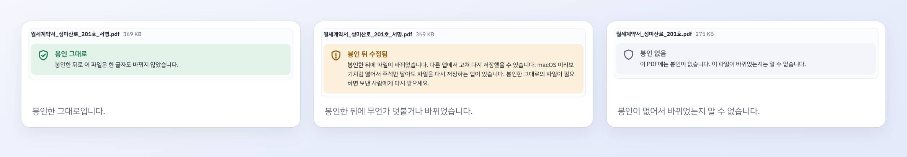
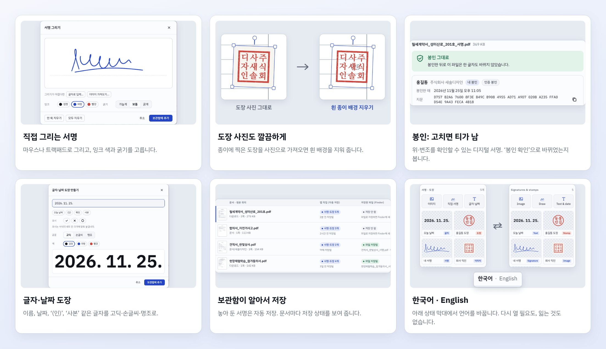
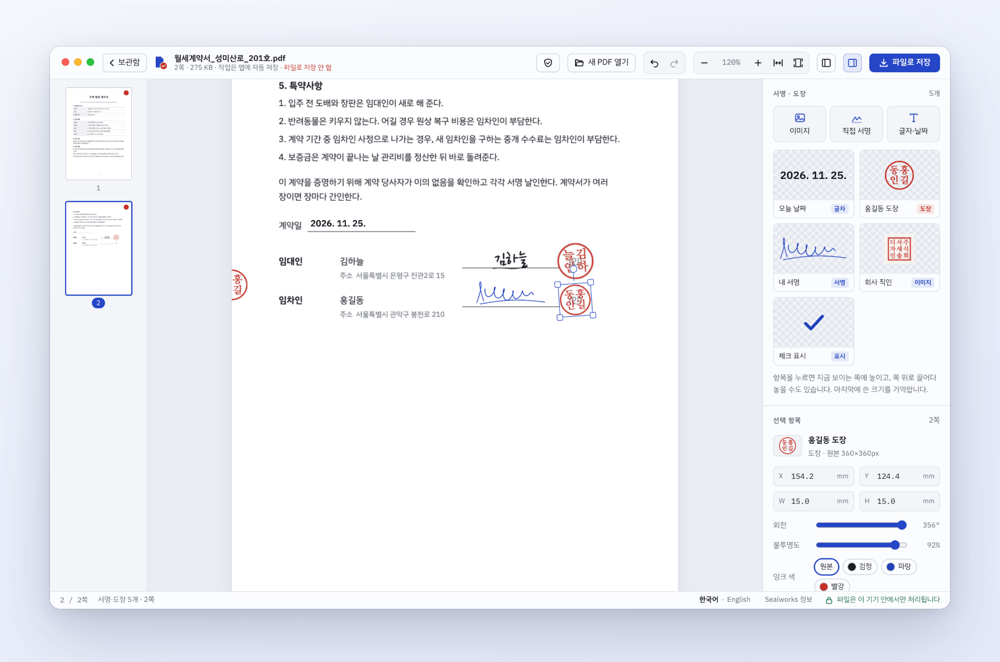
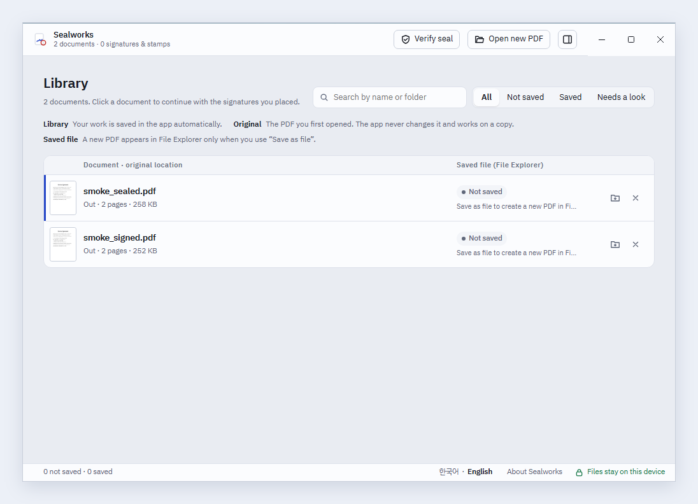
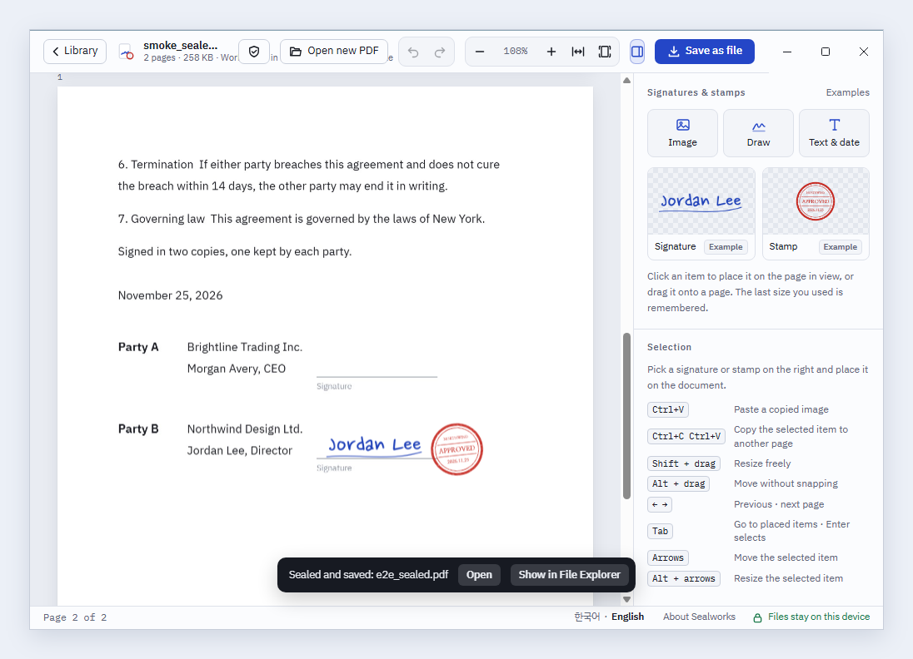
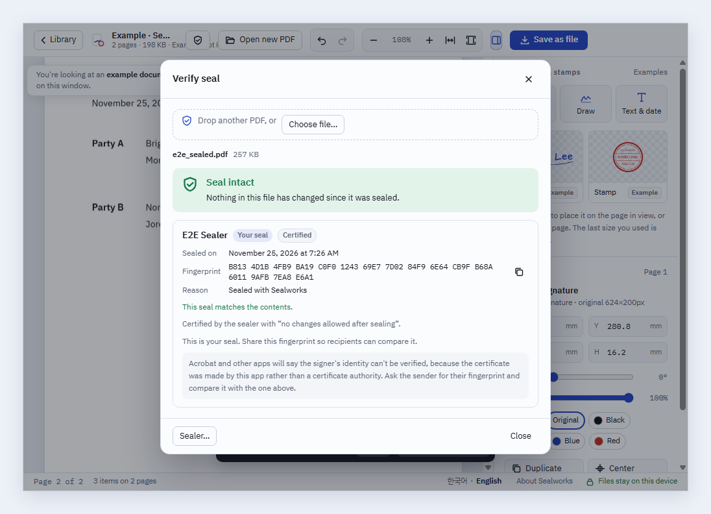

<div align="center">

# Sealworks (씰웍스)

**PDF에 서명과 도장을 놓고 새 파일로 저장하세요. 봉인해 두면 나중에 고친 티가 납니다.**

Mac·Windows용 무료 소스 공개 앱입니다. 출력도, 스캔도, 업로드도 필요 없습니다. 파일은 내 컴퓨터 밖으로 나가지 않습니다.

[**다운로드 (macOS · Windows)**](https://github.com/falcons-eyes/pdf-editor/releases/latest) · [사용법](#3단계면-끝) · [봉인](#봉인-고치면-티가-나는-pdf) · [처음 열 때 안내](#처음-열-때-안내) · [English](README.md)



</div>

## 이런 분께

계약서 한 장에 서명하려고 이런 일을 하고 있다면, Sealworks가 도와 드립니다.

- 출력해서 펜으로 서명하고, 다시 스캔해서 보내고 있다.
- 서명 하나 넣자고 유료 프로그램을 쓰기는 아깝다.
- 미리보기나 PDF 뷰어로 도장 이미지를 넣으려니 번거롭다.
- 회사 서류를 처음 보는 웹사이트에 올리기가 꺼려진다.



## 3단계면 끝



1. **PDF 열기**: `새 PDF 열기`를 누르거나, PDF를 창에 끌어다 놓습니다.
2. **서명·도장 놓기**: 오른쪽 `서명 · 도장` 목록에서 하나를 누르거나, 원하는 자리로 끌어다 놓습니다. 모서리를 끌면 크기가, 위쪽 동그라미를 끌면 각도가 바뀝니다.
3. **새 파일로 저장**: `파일로 저장`을 누르면 원본 옆에 `계약서_서명.pdf`처럼 이름 뒤에 `_서명`이 붙은 새 PDF가 생깁니다. 원본은 그대로입니다. 나중에 고친 티가 나게 하려면 `봉인해서 저장`을 켭니다.

## 봉인: 고치면 티가 나는 PDF



**무엇을 하나요.** `봉인해서 저장`으로 저장하면, 완성된 PDF에 디지털 서명(PAdES)을 넣습니다. 봉인은 파일의 모든 바이트를 덮습니다. 그 뒤로 누가 파일을 한 글자라도 고치면 봉인이 맞지 않게 되어 바로 드러납니다. 봉인이 사본을 고치지 못하게 막지는 못합니다. 고친 것을 숨길 수 없게 할 뿐입니다.

처음 봉인할 때 이름(원하면 소속도)을 묻습니다. 그러면 Sealworks가 이 컴퓨터에 봉인하는 사람 정보, 곧 개인 키와 그 이름이 든 인증서를 만듭니다. 이 이름은 봉인하는 모든 파일에 들어갑니다.



**Sealworks에서 확인하기.** 제목 막대(또는 보관함 화면)의 `봉인 확인`을 누르고, PDF를 창에 끌어다 놓거나 `파일 고르기…`를 누릅니다. 확인만 하고 보관함에는 넣지 않습니다. 결과는 다음 중 하나입니다.

| 결과 | 뜻 |
| --- | --- |
| **봉인 그대로** | 봉인한 뒤로 파일이 한 글자도 바뀌지 않았습니다. |
| **봉인 뒤 수정됨** | 봉인한 뒤에 파일이 바뀌었습니다. 다른 앱에서 고쳐 다시 저장했을 수 있습니다. 보낸 사람에게 파일을 다시 받으세요. |
| **봉인이 올바르지 않음** | 봉인이 파일 내용과 맞지 않거나 손상되었습니다. 이 파일을 그대로 믿지 마세요. |
| **봉인 없음** | 봉인이 없어서 파일이 바뀌었는지 알 수 없습니다. |

결과에는 누가, 언제 봉인했는지와 인증서 **지문**도 나옵니다.

**Adobe Acrobat에서 확인하기.** Acrobat이나 무료 Acrobat Reader에서 PDF를 열고 서명 패널을 엽니다. 서명한 뒤에 문서가 바뀌었는지 보여 줍니다. 서명자 신원은 확인할 수 없다고도 나오는데, 정상입니다. 인증서를 인증기관에서 받은 것이 아니라 보낸 사람의 컴퓨터에서 Sealworks가 만들었기 때문입니다.

**누가 봉인했는지 확인하기.** 인증서를 직접 만들었기 때문에, 봉인에 든 이름은 봉인한 사람이 적은 이름일 뿐입니다. 특정한 사람이 보낸 파일인지 확인하려면 지문을 비교하세요. 보내는 사람은 `봉인하는 사람…`에서 자기 지문을 보고(‘봉인 확인’에도 나옵니다), 전화나 직접 만나서 한 번 알려 줍니다. 파일의 지문이 같으면 그 사람의 키로 봉인한 파일입니다.

**알아 두세요**

- 봉인은 위·변조를 드러낼 뿐 막지는 않습니다. 누군가 봉인을 떼어 내고 봉인 없는 보통 PDF로 넘기는 것도 막을 수 없습니다. 봉인이 중요하다면 봉인이 있는지부터 확인하세요.
- 봉인한 PDF를 다른 앱에서 다시 저장하면 대개 봉인이 깨집니다. macOS 미리보기는 메모나 형광펜만 더해도 파일을 다시 저장할 수 있습니다. 받은 파일은 받은 그대로 두세요.
- 봉인은 파일이 바뀌었는지 확인하기 위한 기능입니다. 어떤 법령상 인정된 전자서명도 아닙니다. 특정한 전자서명이 필요한 문서라면 받는 곳이나 관련 법령의 요구 사항을 먼저 확인하세요.
- **봉인 키를 백업하세요.** 봉인하는 사람 정보는 이 컴퓨터에만 있습니다. `봉인하는 사람…` › `백업…`으로 암호를 건 `.p12` 파일로 저장해 두세요. 백업 없이 컴퓨터를 잃어버리거나 초기화하면 새로 만들어야 하고, 지문도 바뀝니다. `가져오기…`로 백업을 되살리거나, 이미 가진 `.p12`·`.pfx` 인증서를 쓸 수 있습니다.

## 할 수 있는 일



| | |
| --- | --- |
| **직접 서명** | 마우스나 트랙패드로 그립니다. 잉크는 검정·파랑·빨강, 굵기는 세 가지. |
| **도장·이미지** | PNG·JPG를 가져오거나 붙여넣기(⌘V / Ctrl+V). 종이에 찍은 도장 사진은 흰 배경을 지워 줍니다. |
| **글자·날짜 도장** | 이름, 오늘 날짜, `(인)`, `사본` 같은 글자를 고딕·손글씨·명조로 만듭니다. |
| **자리 맞추기** | 크기, 회전, 불투명도, 잉크 색. mm 단위로 위치를 적을 수도 있고, 맞춤선이 도와 줍니다. |
| **여러 쪽** | 고른 항목을 다른 쪽에 복사하거나, `모든 쪽의 같은 위치에 넣기`로 한 번에 넣습니다. |
| **한 번 등록하면 계속** | 등록한 서명·도장은 남아 있어서 다음 문서에서 바로 다시 씁니다. |
| **봉인해서 저장** | 위·변조를 확인할 수 있는 디지털 서명을 넣어, 나중에 고치면 티가 나게 합니다. [위의 설명](#봉인-고치면-티가-나는-pdf)을 보세요. |
| **보관함이 자동 저장** | 연 문서와 놓아 둔 서명은 앱에 자동으로 저장됩니다. 나중에 이어서 고칠 수 있습니다. 문서마다 `저장 전` · `파일 저장됨` · `확인 필요`로 상태를 보여 줍니다. |
| **원본이 바뀌면 알려 줌** | Finder·탐색기에서 원본이나 저장한 파일을 옮기거나, 이름을 바꾸거나, 고치면 알려 줍니다. 옮긴 원본은 다시 연결할 수 있습니다. |
| **실행 취소** | 실수해도 ⌘Z / Ctrl+Z로 되돌립니다. |
| **한국어·영어** | 언제든 바꿀 수 있습니다. [아래](#언어)를 보세요. |
| **내 컴퓨터 안에서만** | 인터넷 연결 없이 동작합니다. 업로드도, 계정도, 사용 기록 수집도 없습니다. |

## 화면

macOS



Windows (1.1 버전, Windows 빌드 서버에서 찍은 영어 화면)

<table>
  <tr>
    <td></td>
    <td></td>
    <td></td>
  </tr>
</table>

## 다운로드

[**최신 버전 받기 →**](https://github.com/falcons-eyes/pdf-editor/releases/latest)

| 컴퓨터 | 받을 파일 |
| --- | --- |
| Mac (Apple Silicon: M1, M2, M3, M4…), macOS 13 이상 | `Sealworks-1.1.0-arm64.dmg` |
| Mac (Intel), macOS 13 이상 | `Sealworks-1.1.0-x64.dmg` |
| Windows 10 · 11 (64비트) | `Sealworks-1.1.0-setup-x64.exe` (설치형) |
| Windows, 설치 없이 | `Sealworks-1.1.0-portable-x64.exe` (바로 실행) |

Mac App Store: 곧 나옵니다.

> 내 Mac이 어느 쪽인지 모르겠다면: 화면 왼쪽 위 사과 메뉴 › **이 Mac에 관하여**에서 `칩`이 Apple M…이면 Apple Silicon, `프로세서`가 Intel…이면 Intel입니다.

## 처음 열 때 안내

DMG와 EXE는 Apple·Microsoft의 유료 인증서로 서명하지 않았습니다. 그래서 처음 한 번은 경고가 뜹니다. 아래처럼 한 번만 허락하면 그다음부터는 그냥 열립니다.

### macOS

1. 받은 DMG를 열고 **Sealworks**를 `응용 프로그램` 폴더로 끌어다 놓습니다.
2. 처음 열 때 "확인되지 않은 개발자" 또는 "악성 코드가 없는지 확인할 수 없습니다"라는 창이 뜨면 **완료**(또는 취소)를 누릅니다.
3. Finder › 응용 프로그램에서 **Sealworks를 우클릭(control-클릭) › 열기**를 누르고, 다시 **열기**를 누릅니다.
4. 그래도 열기 버튼이 없으면 **시스템 설정 › 개인정보 보호 및 보안**으로 가서, 아래쪽의 Sealworks 안내 옆 **그래도 열기**를 누릅니다. (macOS 15 Sequoia부터는 이 방법을 씁니다.)

<details>
<summary>"손상되었기 때문에 열 수 없습니다"라고 나올 때</summary>

인터넷에서 받은 파일에 붙는 표시 때문입니다. 터미널에 아래를 붙여넣고 엔터를 누른 뒤 다시 열어 보세요.

```sh
xattr -dr com.apple.quarantine "/Applications/Sealworks.app"
```

</details>

### Windows

1. 받은 `…-setup-x64.exe`를 실행합니다.
2. "Windows의 PC 보호" 파란 창이 뜨면 **추가 정보**를 누르고 **실행**을 누릅니다.
3. 설치가 끝나면 시작 메뉴에서 **Sealworks**를 엽니다. PDF 파일을 우클릭 › 연결 프로그램에서도 고를 수 있습니다.

## 개인정보와 데이터

- PDF와 이미지는 **이 컴퓨터 안에서만** 처리됩니다. 앱은 파일을 어디로도 보내지 않고, 인터넷을 쓰지 않습니다.
- 원본 PDF는 **바꾸지 않습니다**. 앱은 보관함에 넣어 둔 사본으로 작업하고, `파일로 저장`을 할 때만 새 PDF를 만듭니다.
- 보관함(문서 사본, 놓아 둔 서명 위치, 등록한 서명·도장, 설정)은 아래 폴더에 저장됩니다.

| 운영체제 | 저장 위치 |
| --- | --- |
| macOS | `~/Library/Application Support/PDF Editor` |
| Windows | `%APPDATA%\PDF Editor` |

앱 이름이 PDF Editor였을 때의 폴더 이름을 그대로 씁니다. 그래서 1.0에서 업데이트해도 문서가 모두 남아 있습니다. 보관함을 완전히 지우려면 앱을 닫고 이 폴더를 지우면 됩니다. 앱을 삭제해도 이 폴더는 남아 있습니다.

- 봉인 키는 이 폴더 안의 `seal` 폴더에, macOS 키체인이나 Windows(DPAPI)가 지키는 키로 암호화해서 저장합니다. 컴퓨터 밖으로 나가지 않습니다. 다만 봉인한 PDF에는 내 이름, 인증서 지문, 봉인 시각이 들어가므로, 파일을 받는 사람도 볼 수 있습니다.

자세한 내용은 [개인정보 처리방침](PRIVACY.md#한국어)을 보세요.

## 언어

Sealworks는 한국어와 영어를 지원합니다. 처음 열 때는 컴퓨터의 언어를 따릅니다. 바꾸려면 창 오른쪽 아래 상태 막대의 `한국어` 또는 `English`를 누르거나, **보기 › 언어**를 고릅니다. 다시 열지 않고 그 자리에서 바뀌며, 하던 작업도 그대로입니다. 고른 언어는 기억합니다.

## 직접 빌드

[Node.js](https://nodejs.org/) LTS가 필요합니다.

```sh
cd desktop
npm ci
npm start           # 개발용으로 실행
npm run dist:mac    # desktop/dist/ 에 DMG (Apple Silicon, Intel)
npm run dist:win    # desktop/dist/ 에 설치형·실행형 EXE
```

자세한 내용은 [desktop/README.md](desktop/README.md)를 보세요.

- 화면은 [web/pdf-editor.html](web/pdf-editor.html) 한 파일입니다. `python3 web/dev_server.py`로 브라우저에서 미리 볼 수 있습니다.
- README 이미지는 [docs/tools/render.sh](docs/tools/render.sh)로 실제 화면에서 한국어·영어 두 벌을 다시 만들 수 있습니다. 가상의 문서만 씁니다.
- 예전 Python(Tkinter) 시제품은 삭제했습니다. v1.1.0까지의 git 기록에 남아 있습니다.

## 라이선스

Sealworks는 **소스 공개** 소프트웨어입니다. 코드는 모두 여기서 볼 수 있지만, 오픈소스는 아닙니다. 소스 코드의 라이선스는 [PolyForm Strict License 1.0.0](LICENSE)이고, 공식 앱에는 [추가 권한](LICENSE-PERMISSIONS.md#한국어)을 드립니다.

Copyright (c) 2026 Falcon Eyes Inc. (주식회사 팔콘아이즈). Sealworks — https://sealworks.falconoon.com

간단히 정리하면 이렇습니다. 효력이 있는 것은 [LICENSE](LICENSE)와 [LICENSE-PERMISSIONS.md](LICENSE-PERMISSIONS.md)의 영문 원문입니다.

- **공식 앱은 누구나, 어떤 목적으로든 무료로 쓸 수 있습니다.** 회사를 포함해 누구나 GitHub Releases, Mac App Store, Microsoft Store(Google Play는 나중에)에서 받은 고치지 않은 공식 Sealworks 앱을 설치해 쓸 수 있습니다. 계약서 서명 같은 업무용도 됩니다.
- **공식 앱은 나눠 줄 수 있습니다.** 공식 앱 파일을 고치지 않은 그대로, 무료로, 라이선스와 함께, Sealworks 이름과 아이콘을 그대로 둔 채 나눠 줄 수 있습니다.
- **소스 코드는 비상업적 목적으로만 쓸 수 있습니다.** 개인 공부·취미·연구·실험, 그리고 자선단체, 교육기관, 공공 연구기관, 공공 안전·보건 기관, 환경보호 단체, 정부기관의 사용이 여기에 해당합니다.
- **따로 라이선스가 필요한 것:** Sealworks를 고치거나 이를 바탕으로 새 저작물을 만드는 것(다시 포장하거나 이름을 바꾼 빌드 포함), 소스 코드나 고친 사본을 나눠 주는 것, 사본에 돈을 받는 것, 소스 코드의 상업적 사용, [TRADEMARKS.md](TRADEMARKS.md#한국어) 범위를 넘어 Sealworks 이름과 아이콘을 쓰는 것. [COMMERCIAL.md](COMMERCIAL.md#한국어)를 보거나 support@falconoon.com으로 문의하세요.
- **기여:** 이슈와 풀 리퀘스트를 환영합니다. [CONTRIBUTING.md](CONTRIBUTING.md#한국어)를 보세요. 보안 문제를 찾았다면 [SECURITY.md](SECURITY.md#한국어)를 보세요.

**이전 버전은 MIT였습니다.** v1.1.0까지의 버전과, 라이선스를 바꾸기 전에 이 저장소에 공개된 모든 내용은 MIT 라이선스로 배포되었습니다. MIT로 받은 사본에는 계속 MIT 조건이 적용됩니다. v1.1.0 다음 릴리스부터 Sealworks의 라이선스는 PolyForm Strict 1.0.0과 위의 추가 권한입니다. MIT 라이선스는 저작권에 관한 것이라, 처음부터 Sealworks라는 이름이나 아이콘을 쓸 권리는 주지 않았습니다.

Sealworks가 쓰는 오픈소스 구성 요소입니다. 각자 원래 라이선스를 따르며, 자세한 내용은 [THIRD_PARTY_NOTICES.md](THIRD_PARTY_NOTICES.md)에 있습니다.

- [PDF.js](https://github.com/mozilla/pdf.js) (Apache-2.0)
- [pdf-lib](https://github.com/Hopding/pdf-lib) (MIT)
- [Electron](https://www.electronjs.org/) (MIT)
- [node-forge](https://github.com/digitalbazaar/forge) (BSD-3-Clause 라이선스로 사용)
- [@signpdf](https://github.com/vbuch/node-signpdf) (MIT)
- 글꼴: IBM Plex Sans KR, IBM Plex Mono, 나눔명조, 나눔손글씨 펜 (SIL Open Font License 1.1)

개인정보 처리방침: [PRIVACY.md](PRIVACY.md#한국어) · 문의·버그 신고: [GitHub Issues](https://github.com/falcons-eyes/pdf-editor/issues)
