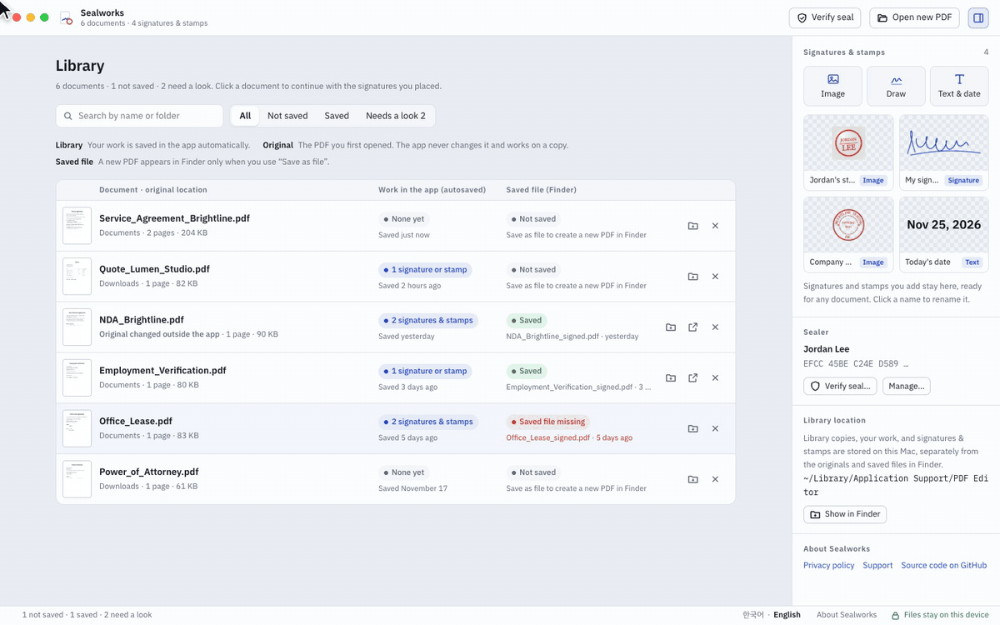
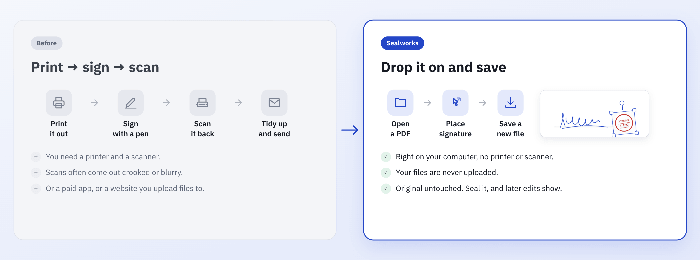
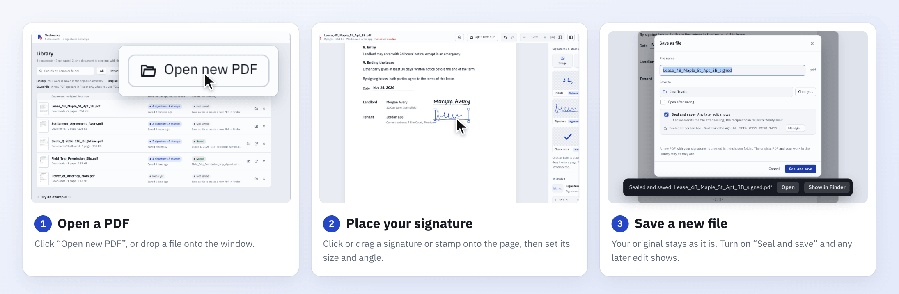
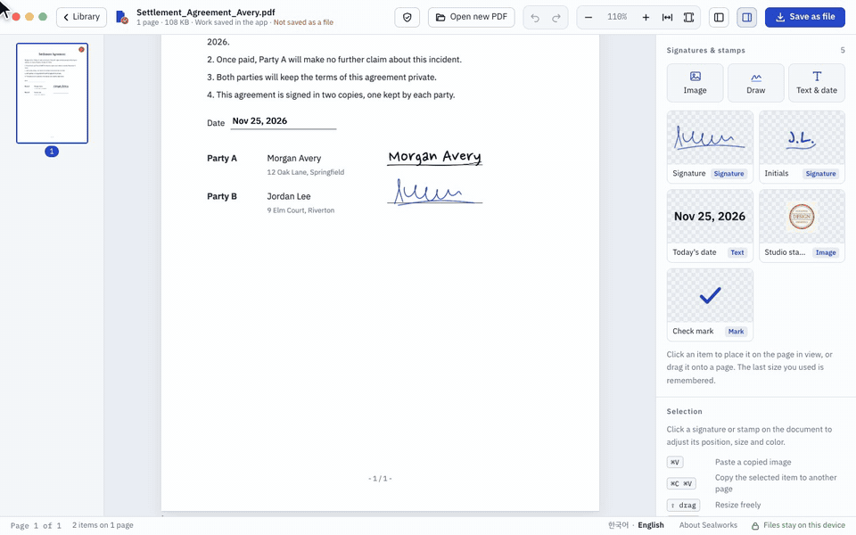
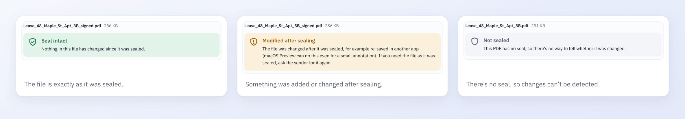
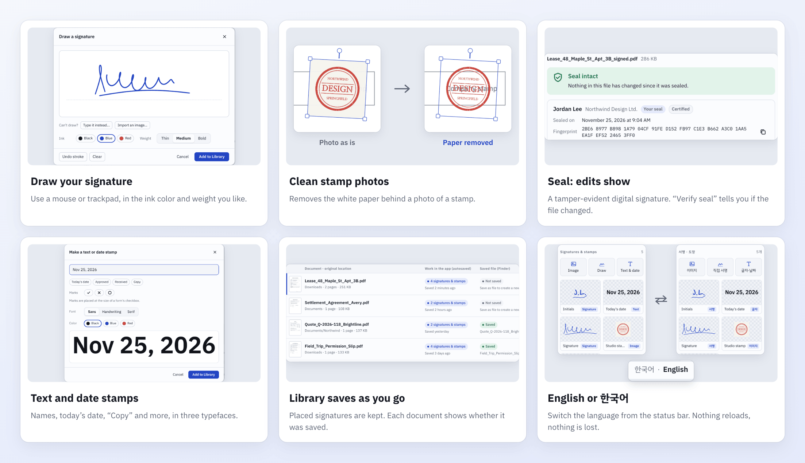
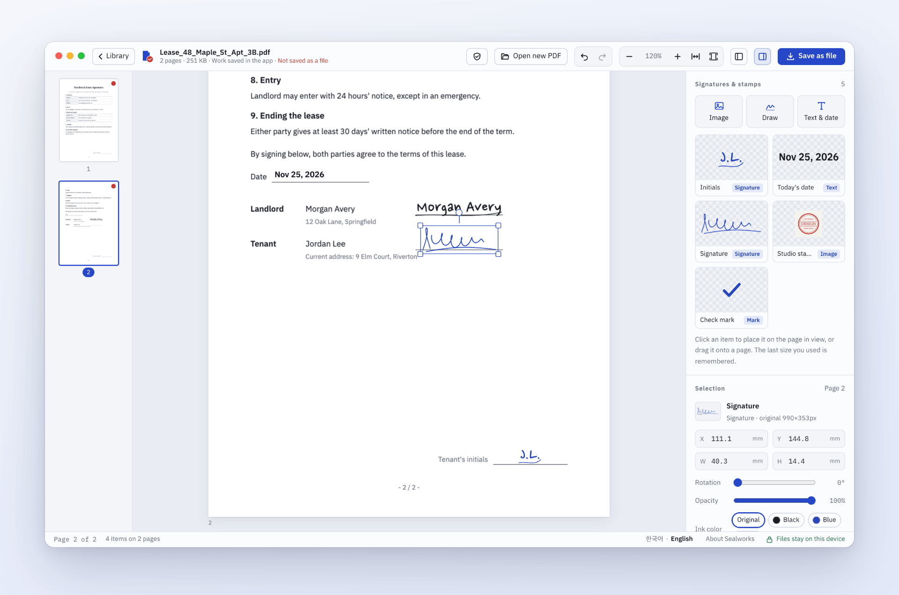
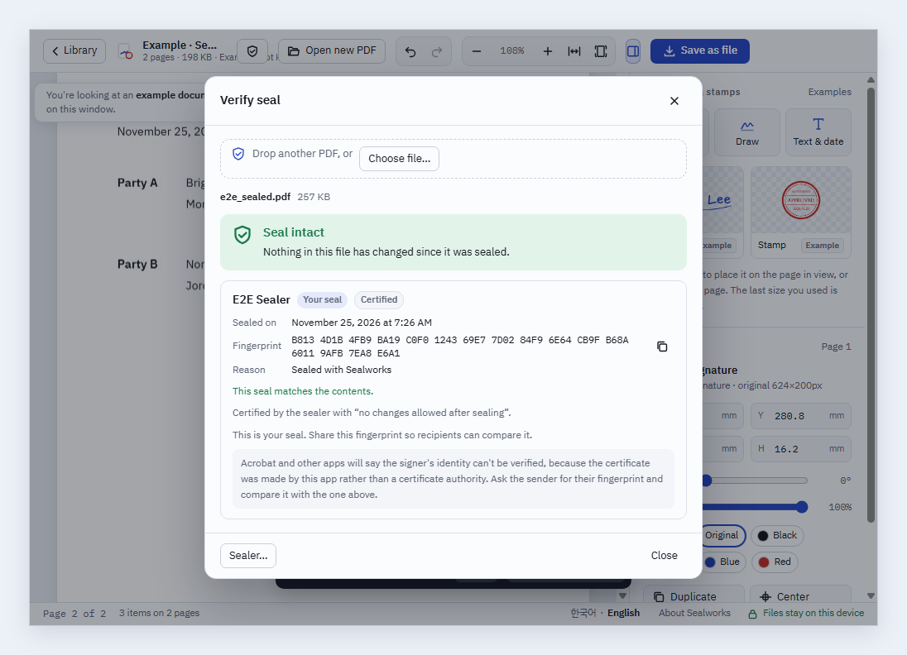

<div align="center">

# Sealworks

**Put your signature and stamp on a PDF, save a new copy, and seal it so any later edit shows.**

Free and source-available for Mac and Windows. No printing, no scanning, no uploading. Your files never leave your computer.

[**Download (macOS · Windows)**](https://github.com/falcons-eyes/pdf-editor/releases/latest) · [How it works](#three-steps) · [Seal](#seal-tamper-evident-pdfs) · [First launch](#first-launch) · [한국어](README.ko.md)



</div>

## Who it's for

If signing one page of a contract means any of these, Sealworks can help.

- You print it, sign it with a pen, scan it again and send it back.
- Paying for Acrobat just to add a signature feels like too much.
- Getting a stamp image into macOS Preview or a PDF viewer is fiddly.
- You'd rather not upload company papers to a website you've never heard of.



## Three steps



1. **Open a PDF.** Click `Open new PDF`, or drop a PDF onto the window.
2. **Place your signature.** Click a signature or stamp in the `Signatures & stamps` list on the right, or drag it where it belongs. Drag a corner to resize it and the round handle on top to rotate it.
3. **Save a new file.** Click `Save as file`. Sealworks creates a new PDF next to the original, named like `Contract_signed.pdf`. Your original stays as it is. Turn on `Seal and save` if you want later edits to show.

## Seal: tamper-evident PDFs



**What it does.** When you save with `Seal and save`, Sealworks adds a digital signature (PAdES) to the finished PDF. The seal covers every byte of the file. If anyone changes the file afterwards, even by one character, the seal no longer matches and the change shows. The seal can't stop anyone from editing a copy. It makes edits impossible to hide.

The first time you seal, Sealworks asks for your name (and, if you like, your organization). It then makes a sealer identity on your computer: a private key and a certificate with that name. The name goes into every file you seal.



**How to check a file in Sealworks.** Click `Verify seal` in the title bar (or on the Library screen), then drop the PDF on the dialog or click `Choose file…`. Checking a file never adds it to your Library. You'll see one of these:

| Result | What it means |
| --- | --- |
| **Seal intact** | Nothing in the file has changed since it was sealed. |
| **Modified after sealing** | The file was changed after sealing, for example re-saved in another app. Ask the sender for the file again. |
| **Seal is not valid** | The seal doesn't match the contents, or it's damaged. Don't rely on the file. |
| **Not sealed** | The PDF has no seal, so there's no way to tell whether it was changed. |

The result also shows who sealed it, when, and the certificate **fingerprint**.

**How to check a file in Adobe Acrobat.** Open the PDF in Acrobat or the free Acrobat Reader and open the Signatures panel. Acrobat shows whether the document was changed after it was signed. It will also say the signer's identity can't be verified. That's expected: the certificate was made by Sealworks on the sender's computer, not bought from a certificate authority.

**Checking who sealed it.** Because the certificate is self-made, the name in a seal only tells you what the sealer typed. To be sure a file came from a particular person, compare fingerprints. The sender finds theirs under `Sealer…` (it's also shown in `Verify seal`) and shares it with you once, for example by phone or in person. If the fingerprint in the file matches, the file was sealed with their key.

**Good to know**

- A seal shows tampering. It doesn't prevent it, and it can't stop someone from removing the seal and sending the file on as an ordinary, unsealed PDF. If a seal matters to you, check that one is there.
- Re-saving a sealed PDF in another app usually breaks the seal. macOS Preview can do this even when you only add a note or highlight. Keep the file exactly as you received it.
- The seal is meant for spotting changes. It isn't a certified electronic signature under any law. If a document needs a particular kind of electronic signature, check what the recipient or the law requires.
- **Back up your seal key.** Your sealer identity lives only on this computer. Use `Sealer…` › `Back up…` to save it as a password-protected `.p12` file. If you lose or reset the computer without a backup, you'll have to make a new identity, and its fingerprint will be different. `Import…` restores a backup, or brings in a `.p12` / `.pfx` certificate you already have.

## Features



| | |
| --- | --- |
| **Draw your signature** | With a mouse or trackpad. Ink in black, blue or red, in three weights. |
| **Stamps and images** | Import a PNG or JPG, or paste one (⌘V / Ctrl+V). For a photo of a stamp on paper, Sealworks removes the white background. |
| **Text and date stamps** | Your name, today's date, “Approved”, “Copy” and more, in sans, handwriting or serif type. |
| **Get the placement right** | Size, rotation, opacity and ink color. Type a position in mm, or let the guides snap it into place. |
| **Many pages** | Copy a placed item to other pages, or use `Put on every page at the same spot`. |
| **Add once, reuse** | Signatures and stamps you add stay in the list, ready for the next document. |
| **Seal and save** | A tamper-evident digital signature, so any later edit shows. [More above](#seal-tamper-evident-pdfs). |
| **Library saves as you go** | Documents you open and the signatures you place are saved in the app automatically, so you can come back later. Each document shows whether it was saved as a file or needs a look. |
| **Tells you when files change** | If the original or the file you saved is moved, renamed or edited in Finder or File Explorer, Sealworks tells you. You can reconnect a moved original. |
| **Undo** | ⌘Z / Ctrl+Z takes back a mistake. |
| **English or Korean** | Switch any time. [See below](#language). |
| **Stays on your computer** | Works offline. No upload, no account, no usage tracking. |

## Screenshots

macOS



Windows (version 1.1, taken on a Windows runner)

<table>
  <tr>
    <td></td>
    <td></td>
    <td></td>
  </tr>
</table>

## Download

[**Get the latest version →**](https://github.com/falcons-eyes/pdf-editor/releases/latest)

| Your computer | File to download |
| --- | --- |
| Mac with Apple silicon (M1, M2, M3, M4…), macOS 13 or later | `Sealworks-1.1.0-arm64.dmg` |
| Mac with an Intel processor, macOS 13 or later | `Sealworks-1.1.0-x64.dmg` |
| Windows 10 or 11 (64-bit) | `Sealworks-1.1.0-setup-x64.exe` (installer) |
| Windows, without installing | `Sealworks-1.1.0-portable-x64.exe` (runs as is) |

Mac App Store: coming soon.

> Not sure which Mac you have? Choose Apple menu › **About This Mac**. If it says `Chip  Apple M…`, you have Apple silicon. If it says `Processor  … Intel …`, you have an Intel Mac.

## First launch

The DMG and EXE downloads aren't signed with paid Apple or Microsoft certificates, so macOS and Windows warn you the first time. Allow it once and it opens normally after that.

### macOS

1. Open the DMG and drag **Sealworks** to the `Applications` folder.
2. If the first launch says the developer can't be verified, or that macOS can't check it for malicious software, click **Done** (or Cancel).
3. In Finder › Applications, **right-click (Control-click) Sealworks › Open**, then click **Open** again.
4. If there's still no Open button, go to **System Settings › Privacy & Security**, scroll down, and click **Open Anyway** next to the message about Sealworks. (From macOS 15 Sequoia on, this is the way.)

<details>
<summary>If it says the app “is damaged and can't be opened”</summary>

That comes from the quarantine flag macOS puts on downloaded files. Paste this into Terminal, press Return, and open the app again.

```sh
xattr -dr com.apple.quarantine "/Applications/Sealworks.app"
```

</details>

### Windows

1. Run the `…-setup-x64.exe` you downloaded.
2. If a blue “Windows protected your PC” box appears, click **More info**, then **Run anyway**.
3. When setup finishes, open **Sealworks** from the Start menu. You can also right-click a PDF › Open with › Sealworks.

## Privacy and your data

- Your PDFs and images are processed **only on this computer**. Sealworks doesn't send them anywhere and doesn't use the network.
- Sealworks **never changes your original PDF**. It works on a copy in the Library and writes a new PDF only when you choose `Save as file`.
- The Library (document copies, where you placed signatures, your signatures and stamps, settings) is kept in this folder:

| System | Folder |
| --- | --- |
| macOS | `~/Library/Application Support/PDF Editor` |
| Windows | `%APPDATA%\PDF Editor` |

The folder keeps its old name from when the app was called PDF Editor, so updating from 1.0 keeps all your documents. To erase the Library completely, quit Sealworks and delete this folder. Uninstalling the app leaves the folder in place.

- Your seal key is stored in that folder's `seal` subfolder, encrypted with a key that macOS Keychain or Windows (DPAPI) protects. It never leaves your computer. Your name, the certificate fingerprint and the time do go into each PDF you seal, so anyone you send it to can see them.

Read the full [privacy policy](PRIVACY.md) and the [terms of use](https://sealworks.falconoon.com/terms/).

## Language

Sealworks speaks English and Korean. The first time it opens, it follows your computer's language. To switch, click `English` or `한국어` at the bottom right of the window (in the status bar), or use **View › Language**. Everything switches in place: nothing reloads, and your work stays where it is. Sealworks remembers your choice.

## Build from source

You need [Node.js](https://nodejs.org/) LTS.

```sh
cd desktop
npm ci
npm start           # run it for development
npm run dist:mac    # DMG files (Apple silicon, Intel) in desktop/dist/
npm run dist:win    # installer and portable EXE in desktop/dist/
```

See [desktop/README.md](desktop/README.md) for details.

- The whole interface is one file, [web/pdf-editor.html](web/pdf-editor.html). You can preview it in a browser with `python3 web/dev_server.py`.
- The README images are made from the real interface with [docs/tools/render.sh](docs/tools/render.sh), in both languages, using made-up documents only.
- The old Python (Tkinter) prototype has been removed. It is still in the git history up to v1.1.0.

## License

Sealworks is **source-available**: you can read all of its code here, but it is not open source. The source code is licensed under the [PolyForm Strict License 1.0.0](LICENSE), with [additional permissions](LICENSE-PERMISSIONS.md) for the official app.

Copyright (c) 2026 Falcon Eyes Inc. (주식회사 팔콘아이즈). Sealworks — https://sealworks.falconoon.com

What that means, in short (the [LICENSE](LICENSE) and [LICENSE-PERMISSIONS.md](LICENSE-PERMISSIONS.md) texts are what count):

- **The official app is free for everyone, for any purpose.** Anyone, including businesses, may install and use the official, unmodified Sealworks app from GitHub Releases, the Mac App Store or the Microsoft Store (Google Play later), including for work such as signing contracts.
- **You can share the official app.** Pass on exact, unmodified copies of the official app files free of charge, together with the license and with the Sealworks name and icon unchanged.
- **The source code is for noncommercial use only.** Personal study, hobby projects, research and experiments, and use by charities, schools, public research bodies, public safety or health organizations, environmental organizations and government institutions.
- **Not allowed without a separate license:** changing Sealworks or making new works based on it (including repackaged or rebranded builds), sharing the source code or changed copies, charging for copies, commercial use of the source code, or using the Sealworks name and icon beyond [TRADEMARKS.md](TRADEMARKS.md). See [COMMERCIAL.md](COMMERCIAL.md) or write to support@falconoon.com.
- **Contributing:** issues and pull requests are welcome. See [CONTRIBUTING.md](CONTRIBUTING.md). Found a security problem? See [SECURITY.md](SECURITY.md).

**Earlier versions were MIT.** Sealworks versions up to and including v1.1.0, and everything published in this repository before the license changed, were released under the MIT License. If you got a copy under MIT, that copy keeps its MIT terms. Starting with the first release after v1.1.0, Sealworks is licensed under PolyForm Strict 1.0.0 with the additional permissions above. The MIT License covers copyright only. It never gave anyone the right to use the Sealworks name or icon.

Sealworks uses these open-source components. They keep their own licenses, listed in [THIRD_PARTY_NOTICES.md](THIRD_PARTY_NOTICES.md):

- [PDF.js](https://github.com/mozilla/pdf.js) (Apache-2.0)
- [pdf-lib](https://github.com/Hopding/pdf-lib) (MIT)
- [Electron](https://www.electronjs.org/) (MIT)
- [node-forge](https://github.com/digitalbazaar/forge) (used under the BSD-3-Clause license)
- [@signpdf](https://github.com/vbuch/node-signpdf) (MIT)
- Fonts: IBM Plex Sans KR, IBM Plex Mono, Nanum Myeongjo, Nanum Pen Script (SIL Open Font License 1.1)

Privacy: [PRIVACY.md](PRIVACY.md) · Questions and bug reports: [GitHub Issues](https://github.com/falcons-eyes/pdf-editor/issues)
