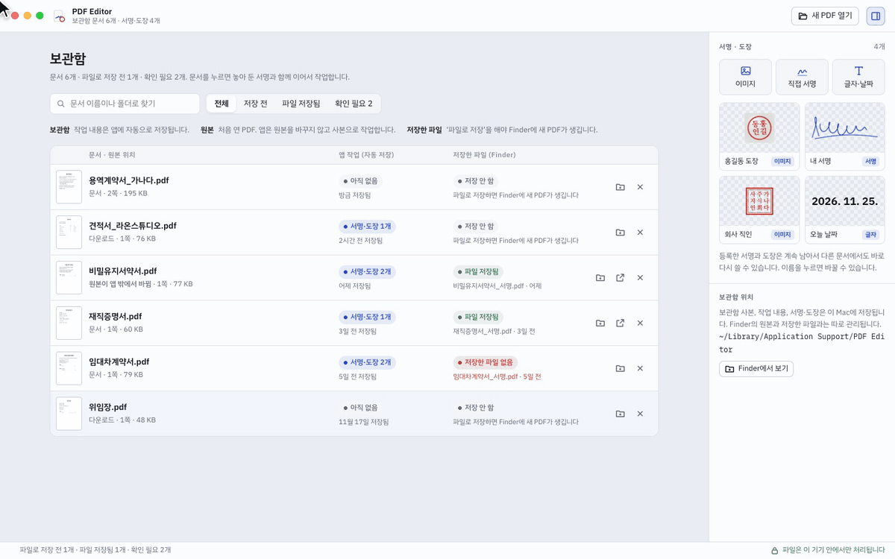
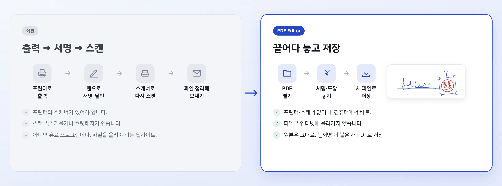
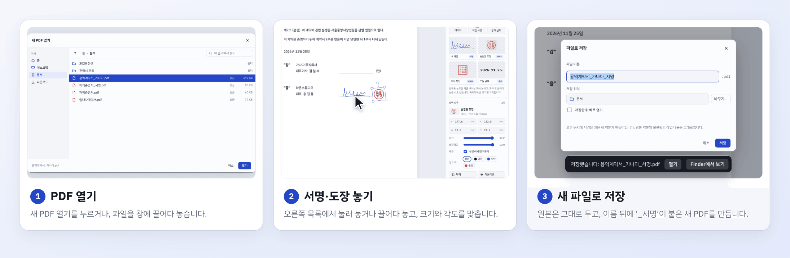
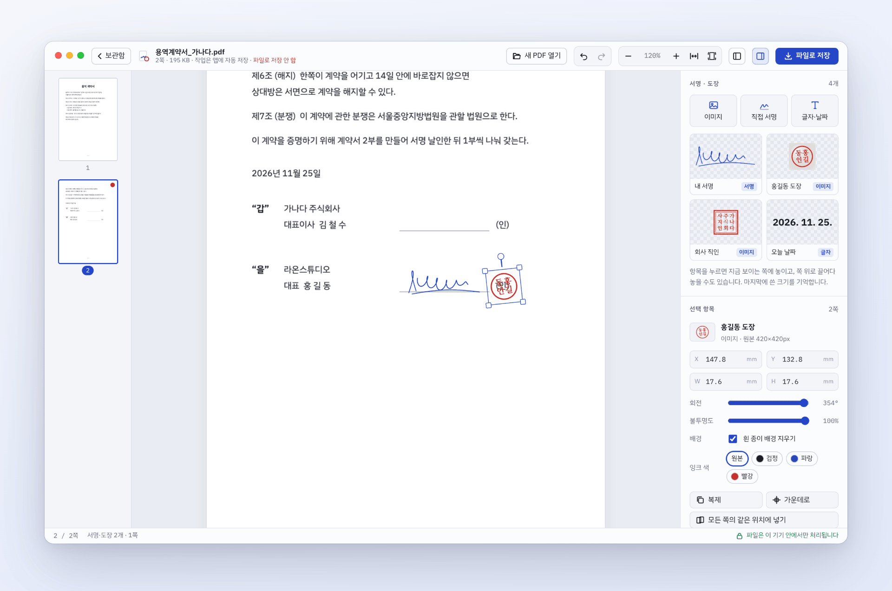
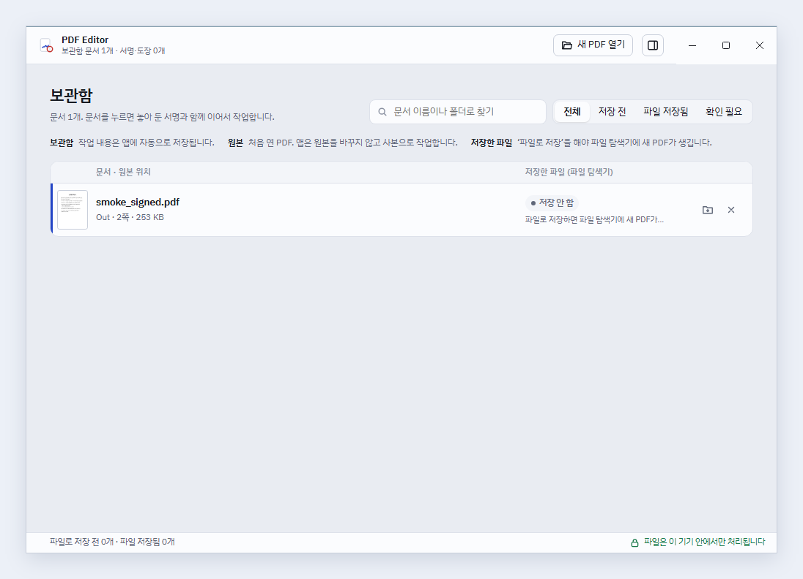
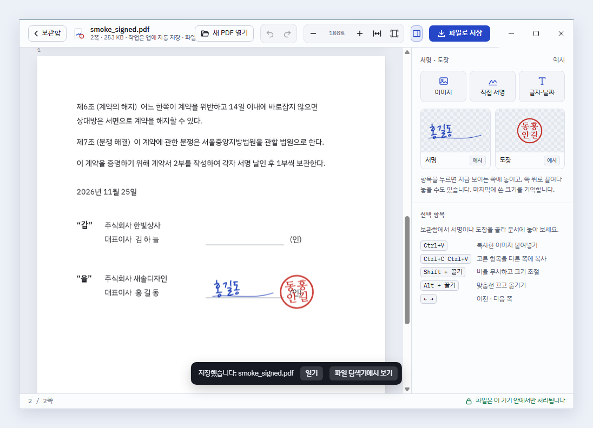

<div align="center">

# PDF Editor

**PDF에 서명과 도장을 끌어다 놓고, 새 파일로 저장하는 무료 앱**

출력도, 스캔도, 업로드도 필요 없습니다. 파일은 내 컴퓨터 밖으로 나가지 않습니다.

[**다운로드 (macOS · Windows)**](https://github.com/falcons-eyes/pdf-editor/releases/latest) · [사용법](#3단계면-끝) · [처음 열 때 안내](#처음-열-때-안내) · [English](#english)



</div>

## 이런 분께

계약서 한 장에 서명하려고 이런 일을 하고 있다면, PDF Editor가 도와 드립니다.

- 출력해서 펜으로 서명하고, 다시 스캔해서 보내고 있다.
- 서명 하나 넣자고 유료 프로그램을 쓰기는 아깝다.
- 미리보기나 PDF 뷰어로 도장 이미지를 넣으려니 번거롭다.
- 회사 서류를 처음 보는 웹사이트에 올리기가 꺼려진다.



## 3단계면 끝



1. **PDF 열기**: `새 PDF 열기`를 누르거나, PDF를 창에 끌어다 놓습니다.
2. **서명·도장 놓기**: 오른쪽 `서명 · 도장` 목록에서 하나를 누르거나, 원하는 자리로 끌어다 놓습니다. 모서리를 끌면 크기가, 위쪽 동그라미를 끌면 각도가 바뀝니다.
3. **새 파일로 저장**: `파일로 저장`을 누르면 원본 옆에 `계약서_서명.pdf`처럼 이름 뒤에 `_서명`이 붙은 새 PDF가 생깁니다. 원본은 그대로입니다.

## 할 수 있는 일


| | |
| --- | --- |
| **직접 서명** | 마우스나 트랙패드로 그립니다. 잉크는 검정·파랑·빨강, 굵기는 세 가지. |
| **도장·이미지** | PNG·JPG를 가져오거나 붙여넣기(⌘V / Ctrl+V). 종이에 찍은 도장 사진은 흰 배경을 지워 줍니다. |
| **글자·날짜 도장** | 이름, 오늘 날짜, `(인)`, `사본` 같은 글자를 고딕·손글씨·명조로 만듭니다. |
| **자리 맞추기** | 크기, 회전, 불투명도, 잉크 색. mm 단위로 위치를 적을 수도 있고, 맞춤선이 도와 줍니다. |
| **여러 쪽** | 고른 항목을 다른 쪽에 복사하거나, `모든 쪽의 같은 위치에 넣기`로 한 번에 넣습니다. |
| **한 번 등록하면 계속** | 등록한 서명·도장은 남아 있어서 다음 문서에서 바로 다시 씁니다. |
| **보관함이 자동 저장** | 연 문서와 놓아 둔 서명은 앱에 자동으로 저장됩니다. 나중에 이어서 고칠 수 있습니다. 문서마다 `저장 전` · `파일 저장됨` · `확인 필요`로 상태를 보여 줍니다. |
| **원본이 바뀌면 알려 줌** | Finder·탐색기에서 원본이나 저장한 파일을 옮기거나, 이름을 바꾸거나, 고치면 알려 줍니다. 옮긴 원본은 다시 연결할 수 있습니다. |
| **실행 취소** | 실수해도 ⌘Z / Ctrl+Z로 되돌립니다. |
| **내 컴퓨터 안에서만** | 인터넷 연결 없이 동작합니다. 업로드도, 계정도, 사용 기록 수집도 없습니다. |

## 화면

macOS



Windows

<table>
  <tr>
    <td></td>
    <td></td>
  </tr>
</table>

## 다운로드

[**최신 버전 받기 →**](https://github.com/falcons-eyes/pdf-editor/releases/latest)

| 컴퓨터 | 받을 파일 |
| --- | --- |
| Mac (Apple Silicon: M1, M2, M3, M4…), macOS 12 이상 | `PDF-Editor-<버전>-arm64.dmg` |
| Mac (Intel), macOS 12 이상 | `PDF-Editor-<버전>-x64.dmg` |
| Windows 10 · 11 (64비트) | `PDF-Editor-<버전>-setup-x64.exe` (설치형) |
| Windows, 설치 없이 | `PDF-Editor-<버전>-portable-x64.exe` (바로 실행) |

> 내 Mac이 어느 쪽인지 모르겠다면: 화면 왼쪽 위 사과 메뉴 › **이 Mac에 관하여**에서 `칩`이 Apple M…이면 Apple Silicon, `프로세서`가 Intel…이면 Intel입니다.

## 처음 열 때 안내

PDF Editor는 무료 앱이라 Apple·Microsoft의 유료 인증서로 서명하지 않았습니다. 그래서 처음 한 번은 경고가 뜹니다. 아래처럼 한 번만 허락하면 그다음부터는 그냥 열립니다.

### macOS

1. 받은 DMG를 열고 **PDF Editor**를 `응용 프로그램` 폴더로 끌어다 놓습니다.
2. 처음 열 때 "확인되지 않은 개발자" 또는 "악성 코드가 없는지 확인할 수 없습니다"라는 창이 뜨면 **완료**(또는 취소)를 누릅니다.
3. Finder › 응용 프로그램에서 **PDF Editor를 우클릭(control-클릭) › 열기**를 누르고, 다시 **열기**를 누릅니다.
4. 그래도 열기 버튼이 없으면 **시스템 설정 › 개인정보 보호 및 보안**으로 가서, 아래쪽의 PDF Editor 안내 옆 **그래도 열기**를 누릅니다. (macOS 15 Sequoia부터는 이 방법을 씁니다.)

<details>
<summary>"손상되었기 때문에 열 수 없습니다"라고 나올 때</summary>

인터넷에서 받은 파일에 붙는 표시 때문입니다. 터미널에 아래를 붙여넣고 엔터를 누른 뒤 다시 열어 보세요.

```sh
xattr -dr com.apple.quarantine "/Applications/PDF Editor.app"
```

</details>

### Windows

1. 받은 `…-setup-x64.exe`를 실행합니다.
2. "Windows의 PC 보호" 파란 창이 뜨면 **추가 정보**를 누르고 **실행**을 누릅니다.
3. 설치가 끝나면 시작 메뉴에서 **PDF Editor**를 엽니다. PDF 파일을 우클릭 › 연결 프로그램에서도 고를 수 있습니다.

## 개인정보와 데이터

- PDF와 이미지는 **이 컴퓨터 안에서만** 처리됩니다. 앱은 파일을 어디로도 보내지 않습니다.
- 원본 PDF는 **바꾸지 않습니다**. 앱은 보관함에 넣어 둔 사본으로 작업하고, `파일로 저장`을 할 때만 새 PDF를 만듭니다.
- 보관함(문서 사본, 놓아 둔 서명 위치, 등록한 서명·도장, 설정)은 아래 폴더에 저장됩니다.

| 운영체제 | 저장 위치 |
| --- | --- |
| macOS | `~/Library/Application Support/PDF Editor` |
| Windows | `%APPDATA%\PDF Editor` |

보관함을 완전히 지우려면 앱을 닫고 이 폴더를 지우면 됩니다. 앱을 삭제해도 이 폴더는 남아 있습니다.

## 직접 빌드

[Node.js](https://nodejs.org/) LTS가 필요합니다.

```sh
cd desktop
npm ci
npm start           # 개발용으로 실행
npm run dist:mac    # desktop/dist/ 에 DMG (Apple Silicon, Intel)
npm run dist:win    # desktop/dist/ 에 설치형·실행형 EXE
```

자세한 내용은 [desktop/README.md](desktop/README.md)를 보세요.

- 화면은 [web/pdf-editor.html](web/pdf-editor.html) 한 파일입니다. `python3 web/dev_server.py`로 브라우저에서 미리 볼 수 있습니다.
- README 이미지는 [docs/tools/render.sh](docs/tools/render.sh)로 실제 화면에서 다시 만들 수 있습니다. 가상의 문서만 씁니다.
- 예전 Python(Tkinter) 버전은 [pdf_overlay_editor_v3.py](pdf_overlay_editor_v3.py)에 남아 있습니다. 더는 고치지 않습니다.

## 라이선스

[MIT](LICENSE) © 2026 falcons-eyes

함께 쓰는 오픈소스: [PDF.js](https://github.com/mozilla/pdf.js) (Apache-2.0), [pdf-lib](https://github.com/Hopding/pdf-lib) (MIT), [Electron](https://www.electronjs.org/) (MIT), IBM Plex Sans KR · 나눔명조 · 나눔손글씨 펜 (SIL OFL 1.1).

---

## English

**PDF Editor** is a free, open-source desktop app for macOS and Windows that lets you place signatures, stamps (도장) and images onto a PDF and save it as a new file. No printing, no scanning, no uploading: everything stays on your computer.

- **Draw your signature** with a mouse or trackpad, or import a PNG/JPG. Photos of a stamp on paper get their white background removed.
- **Text and date stamps** in three typefaces.
- **Drag, resize, rotate**, set opacity and ink color, copy to other pages or to every page at once.
- **Reuse** saved signatures and stamps in every document.
- **Your originals stay untouched.** Saving creates a new PDF named `<name>_서명.pdf` ("signed") next to the original.
- **Library with autosave**: reopen any document with its placed signatures. The app tells you when an original was moved, renamed or edited outside the app.
- **Works offline**, no account, no telemetry. Data lives in `~/Library/Application Support/PDF Editor` (macOS) or `%APPDATA%\PDF Editor` (Windows).

**Download:** [latest release](https://github.com/falcons-eyes/pdf-editor/releases/latest): `…-arm64.dmg` (Apple Silicon), `…-x64.dmg` (Intel Mac), `…-setup-x64.exe` (Windows installer) or `…-portable-x64.exe`.

**First launch:** the app is not signed with a paid certificate, so macOS and Windows warn once. On macOS, right-click the app in Applications › Open, or use System Settings › Privacy & Security › Open Anyway. On Windows, click "More info" › "Run anyway" in the SmartScreen dialog.

**Build from source:** `cd desktop && npm ci && npm run dist:mac` (or `dist:win`). See [desktop/README.md](desktop/README.md). The UI is Korean.

License: [MIT](LICENSE).
