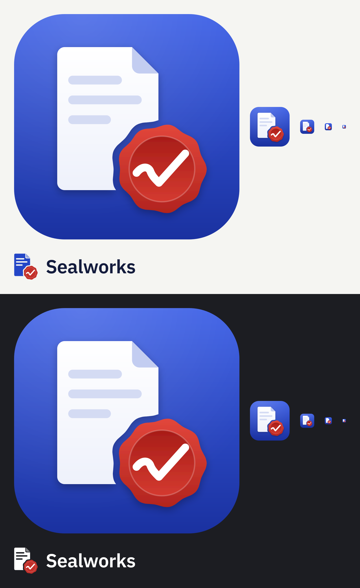

# Sealworks brand mark



## Concept

A page closed with a **wax seal**. The seal straddles the page's corner and takes a bite out of
it, the way a seal across an edge shows when something was opened or changed: Sealworks seals
a PDF so any later edit is visible. Pressed into the wax is one pen stroke, a signature swash
that ends in a tick: the document has been signed, and the seal checks out.

The mark uses no lettering of any script, so it works in every market. The red wax and the white
page carry it at 16 px, where the lines and the swash fade out.

## Files

| File | Use |
|------|-----|
| `sealworks-icon.svg` | App icon master, full-bleed 1024 tile (corner radius 230) |
| `sealworks-icon-small.svg` | 16–32 px cut: no text lines or shadows, a bigger seal, a bolder tick |
| `sealworks-mark.svg` | The symbol without the tile. The page is `currentColor` (ink blue by default) and the seal is seal red |
| `sealworks-mark-mono.svg` | One colour (`currentColor`), with the lines and the tick knocked out. For stamps, embossing and Android's themed icon |
| `sealworks-seal.svg` | The wax seal alone, used as a badge |
| `sealworks-logo-horizontal.svg`, `-dark.svg` | Symbol with the "Sealworks" wordmark (IBM Plex Sans SemiBold, outlined), for light and dark backgrounds |
| `../../site/assets/logo-mark.svg` | Same as `sealworks-mark.svg`, for the website |
| `make-brand.py` | Writes all of the SVGs above (`--preview` writes `preview.png`) |

## Colours

| Role | Value |
|------|-------|
| Ink blue (brand) | `#2446c7` · tile gradient `#3d60e6` → `#1a31a0` |
| Seal red (brand) | `#c3302a` · wax gradient `#e2463b` → `#b2241e` · pressed centre `#a81d18` → `#d43a30` |
| Paper | `#ffffff` → `#eef1fb`, folded corner `#c3cdf1`, lines `#d4dbf3` |
| Wordmark | `#141c3d` on light, `#ffffff` on dark |

In the app's dark theme the header mark takes the theme's `--accent` / `--seal` (`#8299ff` / `#ff7468`).

## Clear space and minimum size

- **Clear space:** keep a margin of at least the seal's radius (about a quarter of the symbol's height) clear on every side of the symbol or lockup.
- **Minimum size:** the symbol at 16 px tall, and the horizontal logo at 20 px tall. Use `sealworks-icon-small.svg` for the app icon at 32 px and below.
- Don't recolour the seal (except in the one-colour mark), add text inside it, rotate it, or set the page in red.

## Regenerating

```sh
python3 docs/brand/make-brand.py              # SVG masters (fontTools; the font comes from desktop/node_modules/@fontsource)
python3 docs/brand/make-brand.py --preview    # preview.png (rsvg-convert + Pillow)
cd desktop && npm run icon && npm run icon:appx
#   build/icon.{png,icns,ico}, build/icon-small.png, build/appx/*,
#   site/assets/{icon-32,icon-180,icon-512,logo-64}.png, site/favicon.ico
cd mobile && npm run icons                    # Android launcher, adaptive, themed and splash icons, store/play-icon-512.png
```

`drawAppIcon()` in `web/pdf-editor.html` draws the same artwork on a canvas for the dock at runtime,
and the header's `.brand-mark` is a 24-unit version of the symbol. If you change the geometry,
update both of them by hand.
